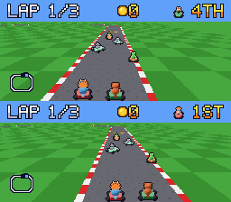
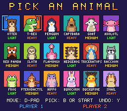
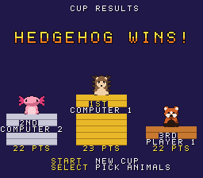

# Couch Kart

An original kart racer for two players on one screen, made as a Super Nintendo game, with the source, the tools and the tests that built it.

The art and names are original. Nothing comes from Nintendo. "Super Nintendo" names the console the game file targets.

## Play it

The file `couch-kart.sfc` runs in a Super Nintendo emulator, or on a device that has one. Two controllers, one for each player.

- **Title:** Start.
- **Pick an animal:** D-pad to move, B or Start to pick, Y to undo your pick. Both players pick at the same time.
- **Track menu:** D-pad up and down to choose, B or Start to start, Y to go back to the animals. Left and right set how many computer karts join.
- **Race:** B or A to drive, D-pad to steer, X to use an item, L or R to hop. Hold L or R through a corner to drift.
- **After a race:** Start for the next one, Select to pick new animals.

## What is in it

- 18 animals in three kart types (light, medium, heavy) that differ in top speed, acceleration and steering.
- Four race tracks of three laps each: Clover Oval, Sandy Twist, Frosty Peaks and Moon Harbour. Each has its own look. Between them are oil, sand, water, a jump ramp, rolling obstacles and a shortcut.
- A cup over all four tracks with points and a podium.
- Two battles on Sunset Arena: balloon battle and coin battle.
- Zero to three computer karts, set in the track menu (three at power-on, zero is the two players alone). They drive, pick up items and use them. Battles are always the two players.
- Coins, item panels, boost pads, a rocket start, hop and drift, a boost for driving close behind the other kart, and a place shown from 1ST up.
- 15 items: boost, shot, homing shot, slime, coins, triple versions of the boost, shot and slime, shield, star, jump, shrink, steal, fake panel and a comet that flies to the kart in first place.

## Build it

Linux x86_64 is what `scripts/setup.sh` supports. It needs `make`, `curl`, `unzip` and Python 3 with pip.

1. `sh scripts/setup.sh` installs PVSnesLib 4.7.0 and four emulator cores into `~/opt/snesdev`, and numpy through pip. The script runs `pip install --user numpy`, which some Python installs refuse. In that case install numpy the way that system expects. See `THIRD-PARTY-NOTICES.md`.
2. `make -C game` builds `game/couchkart.sfc`. A first build generates the pictures, tracks and kart sprites into `game/res/` before it compiles, and keeps the drawn karts in a cache there, so later builds redo only what changed. A clean build gives a file identical to `couch-kart.sfc`.
3. `python3 tools/test_rom.py` plays the built file in three emulator cores and fails when a frame is dropped, the picture differs from a reference renderer or a race rule breaks. `sh scripts/check.sh` runs the setup check, the build and the tests in order.

`tools/retro_run.py` runs a game file headless with scripted button presses and saves screenshots. `tools/break_rules.py` breaks each rule once and reports whether the tests catch it. `docs/engine.md` explains how the game works.

## Change it with Claude

Open Claude Code in this folder and paste one of these prompts. The author has tried neither.

**Make it playable in a browser**

> Read README.md and docs/engine.md. I want to play couch-kart.sfc in a web browser. Propose how to run it on a web page with an open-source Super Nintendo emulator that is compiled for the browser. Before you choose an emulator, name its licence and say what that licence allows, including whether I can publish the page. Ask me before you add any file, download or dependency. Keep couch-kart.sfc unchanged. Then build one page with keyboard controls for two players.

**Make it multiplayer beyond one couch**

> Read README.md and docs/engine.md. I want more than two people to be able to play Couch Kart together. Explain the two routes: more local players on one screen, which the console and the frame budget limit, or play over the network through an emulator's netplay, which needs no change to the game. Recommend one and say why. Ask me before you build anything.

## Limits

- The scripts test the game in three emulator cores: snes9x2002, snes9x2005 and snes9x.
- The author reports that it runs on one retro game stick. No other real device has been tried.
- The game has no sound yet.
- The game is unfinished.

## Licence

MIT, see `../LICENSE` at the repository root. Third-party notices are in `THIRD-PARTY-NOTICES.md`.
