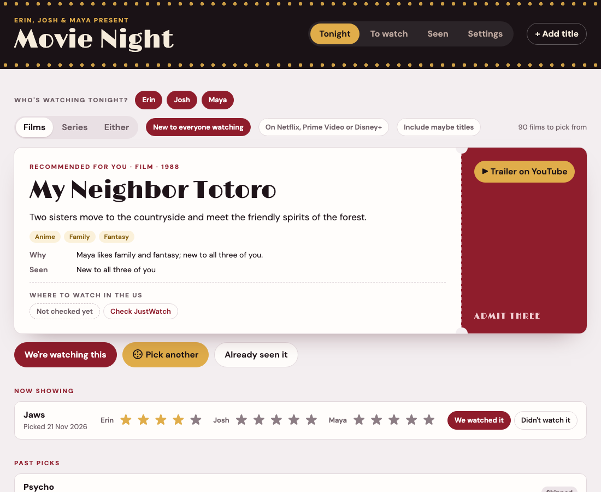

# Movie Night

A page for one to eight people to choose what to watch. You add your genres, favourite films and series and the streaming services you have, and it recommends what to watch. You bring the popcorn.

Why I built it: I had a hard time choosing a film or series to watch. I preferred to back the choice with data and skip the endless scrolling through streaming services.

The marks, stars and notes in the picture are made up.

## Try it

Download the repository from its page on GitHub (**Code**, then **Download ZIP**), unzip it and open `movie-night/movie-night.html` in a browser. It opens on the setup. Press "Skip, show me a sample household" to see it with a made-up household of three. Every button works. Your changes last until you close the tab.

## Make it yours

In the Claude desktop app, open the Code tab, start a new session (**+ New**) with the unzipped folder available to it, and paste this line:

> Read setup.md in the movie-night folder I downloaded and set up my Movie Night. Publish nothing until I confirm.

Claude publishes your private page and tells you to open it. The setup happens on the page: how many of you there are (1 to 8) and your names, your country and streaming services, with a Child toggle for anyone under 12, then for each person the genres they like and the films and series they loved, picked from a list of about 180 well-known titles (three to five is plenty). The country decides which five streaming services are shown, and you can add others by name. A child's picks and Tonight's deals use only family titles. Settings lets you change any of it later.

## What Claude adds

With a Claude plan that allows it, two buttons appear. Claude reads each person's picks and writes a finer taste read (for example "Heist" or "Coming of age"). On Tonight, "Ask Claude for new ideas" suggests five titles none of you have seen, and says which services it thinks carry them. Its streaming notes are guesses, so check them with the look-up link. Without Claude the buttons stay hidden and the page works the same way, with recommendations drawn from the built-in list.

## What it needs

A Claude plan that can publish a private page with a database. I use the page this way with one other person. No other person has run this setup. Whether a second person can save changes from their own account is untested.

## What stays private

Your people, picks, ratings and marks are saved in the database of your own private page, and the downloaded files stay as they are. When you press a Claude button, the picks and names it needs are sent to Claude for that one answer. The page loads its two fonts from Google Fonts, so opening it makes that one request.

## License

MIT, see [../LICENSE](../LICENSE).
